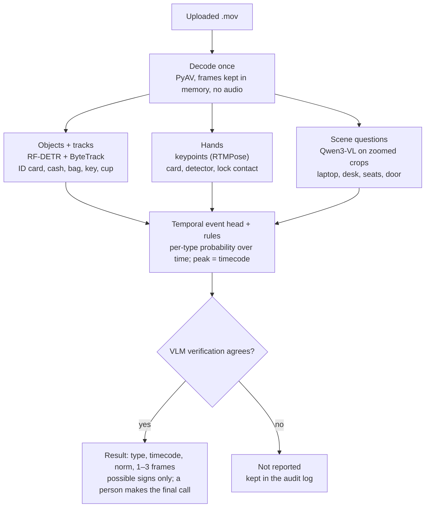

Code Queens

# Forte: plan for raising detection accuracy

Oct 18, 2026 · @RentMao

Today the service scores 34/40 correct verdicts (85%) with 0 false alarms; the plan below targets 40/40 on the training set under leave-one-out testing and 95%+ on new videos. A guaranteed 100% on unseen jury videos is not achievable: the brief says new violation types may appear, and some details are invisible at 464×848.

## Where accuracy is lost today

All 6 misses share one root cause: the per-frame VLM cannot resolve small objects in 464-px video, so their detectors are switched off. The fix is a trained specialist for each object, not more prompting.

| Video | Violation | Why it is missed | Fix |
| --- | --- | --- | --- |
| Х-2 | Cash accepted without ID | Blue banknotes and an ID card look alike to the VLM | Fine-tuned detector with separate `id_card` and `banknote_stack` classes + hand-object tracking |
| Х-22 | Key left in safe lock | Key is ~4×6 px; VLM always says "empty keyhole" | Patch classifier on the lock crop, comparing the lock region before and after the cashier leaves |
| Х-44 | No authenticity check | Detector use is never flagged on the full frame | Hand-to-device interaction: track hand keypoints entering the detector box |
| Х-13 | Bundles stored without recount | Needs the sequence bag → safe with no counting between | Temporal event model over tracked objects |
| Х-1 | Part of the cash kept back | Needs counting notes in two hands | Hand-object tracking + VLM verification on a dense 5 fps clip |
| Х-20 | Unclear | The violation type is not yet identified | Review the clip with the team; add the type if it has a public norm |

The current false-alarm risks are a light object read as a cup, and a person in the doorway counted as an outsider. The same detector fixes both.

## Target architecture

The next version adds a trained object detector and hand tracking next to today's VLM crop questions, and reports an event only when an independent check confirms it.

The detector and hand signals cover exactly the small objects the VLM misses today; the VLM keeps doing what it already does well (screen state, seats, desk contents) and writes the Russian description.

## Modern stack

Every component must be open source with a license that allows commercial use (FAQ 24); licenses marked "check" need a legal read before submission.

| Layer | Choice | License | Why |
| --- | --- | --- | --- |
| Object detector | [RF-DETR](https://blog.roboflow.com/rf-detr-is-free-to-use-commercially/) (fine-tuned) | Apache-2.0 | Real-time DETR, strong on small objects; also has keypoint and segmentation heads. Avoid Ultralytics YOLO: AGPL-3.0 |
| Tracking + zones | Roboflow `supervision` + ByteTrack | MIT | Stable IDs for people, cash, bag; desk / door / safe zones per camera |
| Hands | RF-DETR keypoint or MMPose RTMPose | Apache-2.0 | Hand-to-object contact: ID handed over, note into detector, key in lock |
| Segmentation (labelling aid) | [SAM 3](https://blog.roboflow.com/what-is-sam3/) with text prompts | SAM License (check) | Auto-masks "banknote", "ID card", "key" across a video to speed up labelling; not used at inference |
| Vision-language model | Qwen3-VL-30B-A3B now; evaluate [Qwen3.6-27B](https://playground.roboflow.com/models/qwen/qwen3-6-27b) | Apache-2.0 | Scene questions and final verification; 3.6 adds native video input |
| VLM fine-tuning | Hugging Face PEFT + TRL (LoRA) | Apache-2.0 | Teach the VLM this room, these objects and Russian descriptions |
| Temporal events | Small transformer over tracked-object features (own code, PyTorch) | BSD-3 | Sequences: bag → safe without counting; ID before cash |
| Frame features | SigLIP2 (already on the server) | Apache-2.0 | Cheap embeddings for the temporal model and retrieval |
| Serving | vLLM (VLM) + ONNX Runtime / TensorRT (detector) | Apache-2.0 | Batched VLM calls; detector at 30 fps on one GPU |
| Labelling | CVAT or Label Studio | MIT / Apache-2.0 | Boxes, tracks and event intervals |
| Experiments | MLflow | Apache-2.0 | Every run: data hash, config, per-video results |

Not recommended: super-resolution (Real-ESRGAN etc.) invents detail and would create false evidence; CoTracker3 and VideoMAE weights carry non-commercial licenses.

## Data

40 clips are too few to train detectors; the fastest gain is 2–3 hours of our own recordings (FAQ 7 allows own footage and synthetics).

1. **Record targeted clips** in a similar room with a phone on a high shelf, 3–4 camera positions, each scenario done correctly and incorrectly:
    - ID card shown vs. cash only (use blue and green banknotes next to white and blue cards)
    - key left in the safe vs. removed; detector used vs. skipped
    - bundles counted vs. put straight into the safe; full vs. partial handover
    - door closed vs. open; cup, coat, bag on the desk
2. **Record at higher resolution** (1080p) and downscale copies to 464×848, so models learn at the jury's resolution while labels stay precise.
3. **Auto-label, then verify:** SAM 3 text prompts propose masks and boxes, the current pipeline proposes event times, and a person corrects them in CVAT. Target: about 5,000 labelled frames and 300 event intervals.
4. **Augment for camera angle:** mirror, rotate ±10°, crop and zoom, perspective warp, brightness and white balance, H.264 re-encode. The organisers' final video uses a different angle (FAQ 4).
5. **Keep the 40 supplied clips for evaluation only.** Never train on jury test videos (section 10).

## Training

Three models are trained, smallest first; each one ships only if it beats the current service under the evaluation protocol below.

1. **Object detector (RF-DETR, ~2 h on one A100).** Classes: person, banknote_stack, single_banknote, id_card, cash_bag, coin_tube, cup, coat_or_bag, key_in_lock, laptop_lock_screen, laptop_app, laptop_closed, detector_device, counting_machine, safe_open, door_open. Train at 640–800 px input from 464-px frames, with heavy augmentation; report per-class precision and recall, and require recall ≥ 0.95 on id_card and key_in_lock before use.
2. **VLM LoRA (Qwen3-VL-30B-A3B or Qwen3.6-27B, PEFT + TRL, ~3 h).** Train on crop/question/answer pairs generated from the verified labels ("Is this an ID card or banknotes?", "Is a key in the lock?") plus short Russian descriptions. Merge the adapter for vLLM. Gate: the 8/8-style probe sets must stay perfect and the ID vs. banknote probe must reach ≥ 95%.
3. **Temporal event head (~20 min).** Inputs per 0.5 s: detector counts per zone, hand-object contacts, seat occupancy, SigLIP2 embedding. Output: per-type event probability over time; the timecode is the peak. This replaces hand-written rules only where it is measurably better; rules stay as an explainable fallback.

Decision layer: an event is reported when two independent signals agree (detector + VLM, or temporal head + VLM). Thresholds are set per type for zero false alarms on clean clips, then relaxed until recall stops improving, because the brief says misses are unacceptable.

## Evaluation protocol

A gain counts only if it holds on clips the change was not tuned on; 40/40 reached by tuning on all 40 would prove nothing about the jury videos.

1. **Grouped cross-validation.** Split the 40 clips by scenario group (same room setup and actors), tune on 4 folds, score the 5th, rotate. Report the mean and the worst fold.
2. **Angle test set.** Keep the augmented copies (mirror + zoom, rotation + crop) as a separate gate; today it scores 10/10.
3. **Own-recording hold-out.** One camera position from our recordings is never used for training: this is the closest stand-in for the jury's new angle.
4. **Scored exactly as the jury will:** whole-video verdict (FAQ 15), plus type and timecode error; also run end-to-end through the public API with 5 parallel uploads and fail the build above 240 s.
5. **Regression gate in CI:** `tools/fast_eval.py` runs on every change; a change that adds a single false alarm on the 19 clean clips is rejected.
6. **Error review every run:** look at the evidence frames of each miss and false alarm, write the cause in one line, and fix the cause, never the clip.

## Speed

Today a typical video takes 10–30 s and the worst case (6 long videos at once) 137 s; the target is under 30 s per video even under that load.

- Run the detector on every frame (TensorRT FP16, ~3 ms/frame on an A100) and call the VLM only at moments the detector or temporal head flags, instead of 4–5 VLM calls every second: about 10× fewer model calls.
- vLLM: enable prefix caching (the same instructions repeat on every call), keep `max-num-seqs` at 64, and use guided JSON with short field names to cut generated tokens.
- Decode once with PyAV and keep frames in memory; crop on the GPU.
- On H100 hardware, use FP8 weights for the VLM (about 2× throughput); A100 has no native FP8, so keep bf16 there.
- Admission control: at most 4 jobs analyse at once and the rest queue, so no job can starve past the 5-minute limit.

## Order of work

Before the 12:00 deadline only steps 1–4 fit; the rest is the post-hackathon roadmap if ForteBank takes the solution further.

**Before 12:00 (about 9 hours)**

1. Move the service to the second GPU account with `deploy/bootstrap_fast_host.sh` and re-run the 40-clip evaluation there (1.5 h).
2. Record 30–40 short targeted clips (ID vs. cash, key in lock, detector, door, cup) from 2 phone positions (2 h).
3. Label them with SAM 3 pre-labels + quick review, fine-tune RF-DETR for id_card, banknote_stack, key_in_lock, cup, detector contact; gate it on the 40 clips (3 h).
4. Switch on the disabled types only where the detector passes the gate; freeze, run the full evaluation and the 6-parallel load test, update the submission docs (1.5 h).

**After the hackathon**

5. Expand recordings to 2–3 hours over 4 camera positions; label ~5,000 frames.
6. LoRA-tune the VLM on verified crops; evaluate Qwen3.6-27B against Qwen3-VL-30B-A3B.
7. Train the temporal event head; replace rules type by type where it wins.
8. Move to detector-first inference for 10× fewer VLM calls; add CI regression gates and MLflow tracking.
9. Pilot on real branch footage under bank supervision, measure per-type precision and recall, and review the legal mapping with the bank's compliance team.

## Sources

Current results come from this project's own evaluation (`benchmarks/quality/fast-analyzer-eval.json`, runs rv5 and rv6). Library facts were checked on 18 Oct 2026:

- [RF-DETR is free to use commercially (Apache-2.0)](https://blog.roboflow.com/rf-detr-is-free-to-use-commercially/), Roboflow
- [SAM 3: Segment Anything with Concepts](https://blog.roboflow.com/what-is-sam3/), Roboflow (license: Meta SAM License)
- [Qwen3.6 27B model card summary](https://playground.roboflow.com/models/qwen/qwen3-6-27b), Roboflow Playground (Apache-2.0, released 22 Apr 2026)
- [Qwen3-VL-30B-A3B-Instruct](https://huggingface.co/Qwen/Qwen3-VL-30B-A3B-Instruct), Hugging Face (Apache-2.0)
- ForteBank Datathon brief: sections 7 and 10, FAQ 4, 7, 9, 15, 16, 24
